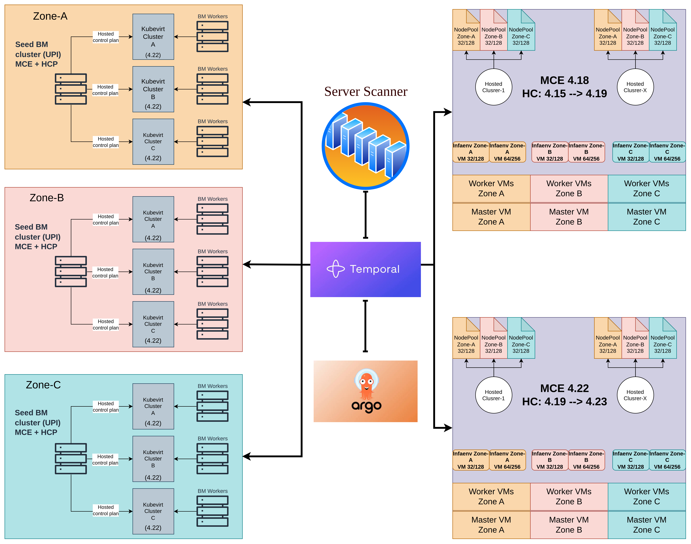

# 70 :: OCP Kubevirt

## 1 :: Requirements

| ID | Requirement | Description |
|---|---|---|
| R1 | OCP cluster creation | The ability to seamlessly orchestrate the end-to-end creation of MCE, KubeVirt, and Hosted clusters via zero-touch automation, leveraging pre-provisioned inventory |
| R2 | OCP Kubevirt cluster Modification | SREs/Admins must be able to dynamically scale tenant worker nodes, modify node pools, and update cluster configuration without disrupting active Hosted Control Planes |
| R3 | OCP Kubevirt cluster Upgrade | The ability to allow hosted/MCE/Kubevirt cluster to be updated with minimal down time and no cross teams operational dependency |
| R4 | OCP Kubevirt cluster Deletion | Clean lifecycle tear-down to release compute, storage, and network resources safely |

---

## 2 :: Quality Goals

| ID | Quality Category | Description |
|---|---|---|
| SC1 | Operability | The solution can be understood, learned and used |
| SC2 | Predictability | The platform must deliver deterministic execution times for administrative operations and consistent, benchmarkable performance under varying cluster loads |
| SC3 | Availability | The service remain available and perform at accepted level even during partial component degradation |
| SC4 | Utilization | The solution capable of producing desired results with little or no waste of time or materials |
| SC5 | Scalability | The platform autonomously manages its own infrastructure capacity, provisioning new cells before existing ones reach saturation and decommissioning underutilized cells to reclaim resources |

### 2.1 :: Quality Scenarios

| ID | Quality Scenario | Description |
|---|---|---|
| SC1.1 | Ease of Use | A user who does not understand the solution can study it and operate it after familiarizing himself with documentation |
| SC1.2 | Autonomy | The ability of the system or component to operate independently, without requiring continuous manual control or intervention from external entities |
| SC2.1 | Performance Efficiency | Ensures workload execution, latency, and resource consumption remain consistent |
| SC2.2 | Operational Efficiency | Ensures platform management operations (like spinning up Hosted Control Planes via HyperShift or scaling worker nodes) take a deterministic, repeatable amount of time |
| SC3.1 | Resiliency | The service remain available and may not impact SLA during partial hardware failures |
| SC3.2 | Uptime | Any of the solution components including Kubevirt clusters, MCE, hosted cluster, ETCD and so on should remain available at all time |
| SC4.1 | Resources efficiency | maximizing of the supply of materials in order to function effectively, with minimum wasted resource expenses. |

---

## 3 :: Constraints

| ID | Constraint |
|---|---|
| C1 | When using Kubevirt Platform we cannot mix BM (Agent) nodes with VM nodes |
| C2 | Hosted cluster can be only deployed on single kubevirt clusters |
| C3 | Each MCE release supports the current OCP version plus several previous versions (typically up to $N - 3$ or $N - 4$ minor versions) |
| C4 | You cannot deploy or upgrade a Hosted Cluster to an OCP version newer than what your installed MCE Operator supports |
| C5 | It is impossible to accurately predict tenant cluster growth which may impact SLA when kubevirt clusters are full |
| C6 | A single HostedCluster's NodePools cannot span multiple MCE Hubs. The HostedCluster control plane runs on one MCE Hub, and that Hub must manage all NodePools for that cluster. This constrains tenant-to-Hub affinity and impacts capacity planning |
| C7 | KubeVirt Live Migration requires shared storage. VMs can only live-migrate between hypervisor nodes that share a storage backend (ODF). This is a KubeVirt/libvirt constraint that forced AD2 (ODF over LVMO). It also means live migration cannot cross AZ boundaries if ODF clusters are AZ-scoped |
| C8 | |

---

## 4 :: Quality Controls

|  | OCP Kubevirt cluster creation | OCP Kubevirt cluster Modification | OCP Kubevirt cluster Upgrade | OCP Kubevirt cluster Deletion |
|---|---|---|---|---|
| **Ease of Use** | 1. Self-service catalog exposes pre-packaged NodePool profiles abstracting Agent/Redfish complexity. 2. AZ allocation and KV/MCE placement complexity is hidden from users to ensure a smooth customer experience | 1. Common modification processes appear in the customer-facing interface as self-service features, eliminating the need to call or explain changes manually | 1. A self-service upgrade process is available for tenants so they can choose the upgrade window themselves | |
| **Autonomy** | 1. Each component in the solution is created before demand arrives to avoid waiting for other resources. For example, VMs are pre-registered in the registry before a hosted cluster claims them | 1. Automated unhealthy worker VM remediation (via Node Health Check) occur without human SRE intervention. | 1. SRE can update master pods independently of tenant workers. 2. NodePool controllers autonomously drive the rolling upgrade state machine (surge, cordon, drain, replace) across isolated AZs (ADB) without manual inspection. | |
| **Performance Efficiency** | 1. VMs allocated with 1:1 CPU/memory at KubeVirt level (AD16 — no hypervisor overcommit). 2. To ensure performance, cell boundaries are created for the KV cluster, hub cluster and hosted cluster. Check the cell boundaries with stress tests | 1. Pre-flight capacity checks confirm target hypervisors, Hub, and HostedCluster do not exceed cell boundaries. If they do, the request is routed to a different cell with headroom or rejected with capacity feedback. | 1. Rolling Machine Replacements are configured with a strict surge strategy (`maxSurge > 0`, `maxUnavailable = 0`); new worker VMs are fully provisioned before old nodes are drained, ensuring tenant compute capacity never drops during updates | |
| **Operational Efficiency** | 1. Cluster creation process is documented and tested to ensure no question asked during manual creation. 2. VMs are pre-registered to the to the MCEs inventory to minimize creation time. 3. VMs are dynamically created on BM nodes and added to server scanner to fulfill inventory requirements | 1. Background reconciliation loop evaluates MCE desired state vs. actual node count at a configurable interval and adds nodes accordingly. 2. Concurrent scale requests for the same cluster are serialized via Temporal workflow locking to prevent conflicting Git commits | 1. Separating Hub control plane updates from KubeVirt worker updates ensures that unpredictable tenant workload drain times cannot delay or block API availability. 2. Nodes can be loaned deterministic to allow a complete replacement of old nodes with newer nodes version by replacing old nodepool with new nodepool | 1. Deleted nodes return to inventory. If the inventory exceeds the required node count, excess nodes are removed from inventory and marked as available in the server scanner |
| **Resiliency** | 1. Control plane pods (Hub) and worker VMs (KubeVirt) are strictly provisioned using `podAntiAffinity` and `topologySpreadConstraints` to ensure no single hardware rack or AZ failure can take down a tenant's quorum. 2. Worker VMs are labeled with the hosted cluster name to evaluate `topologySpreadConstraints` against | 1. If underlying hypervisors require maintenance or exhibit partial degradation, KubeVirt Live Migration shifts active tenant worker VMs to healthy hosts without dropping network connections. 2. if a scale-up VM fails to join the cluster within a defined timeout, Temporal selects an alternative node from inventory and executes a compensating transaction to release the failed node back to quarantine. | 1. Hub control plane upgrades roll sequentially (e.g., `maxUnavailable=1`), ensuring ETCD and API servers retain a functional 2-of-3 quorum even if an AZ drops mid-upgrade. 2. Because upgrades use a surge replacement strategy, a failure in the upgrade process may only impact new nodes leaving older nodes intact. older nodes will evacuate only when new nodes provisioned successfully | 1. Deletion ensures the node has no workloads before removal from the cluster |
| **Uptime** | 1. Control plane components (3x API / 3x ETCD) and worker VMs are scheduled across 3 physical Availability Zones using strict `podAntiAffinity`. No single AZ failure causes API unavailability. | 1. Pre-flight health checks validate control plane health (API server responding, ETCD quorum intact, no degraded ClusterOperators) before executing any modification. If any check fails, the operation is queued and the requestor is notified. 2. KV clusters must have at least 15% of untouched servers for vmotion | 1. Pre-flight validates cluster health, ETCD backup taken, and no in-progress operations before starting. Rolling upgrade uses `maxSurge > 0`, `maxUnavailable = 0` for workers. 2. Control plane upgrades maintain ETCD 2-of-3 quorum throughout. 3. MCE upgrades must precheck hostedclusters version and calculate the version skew policy. 4. KV cluster must evacuate VMs before updating worker nodes | |
| **Resources efficiency** | 1. Worker VMs drawn from pre-provisioned MCE inventory (warm pool). Background process detects inventory drop and provisions replacement VMs on bare-metal nodes to replenish pool. Pool depth maintained above defined low watermark. 2. VM ratio of 1:8 is selected to eliminate waist of bare-metal resources | 1. Unused resources bounded to a user can be consumed by different user to a limited time | | |

---

## 5 :: Architectural Decisions

| ID | Decision | Reason |
|---|---|---|
| AD1 | Hypershift as control plan | Decoupling the control plane (running as pods on the Hub) from the data plane drastically reduces resource overhead and accelerates cluster provisioning times compared to traditional standalone OCP clusters. |
| AD2 | NetApp Trident (Shared) instead of LVMO (Local) Storage | NetApp Trident is selected as the primary storage provider. Shared storage is a strict prerequisite to enable KubeVirt Live Migration of VMs across physical hosts during hardware maintenance or failure. |
| AD3 | VM Lifecycle via Agent-Based Bare Metal Provisioning | Utilizing the `kubevirt/redfish-controller`, KubeVirt VMs are exposed with Virtual BMCs. This allows MCE and the Agent-based Installer to provision and manage VMs identically to physical bare-metal servers, unifying the automation pipeline. |
| AD4 | Bare metal to Kubevirt rolling migration | Using `kubevirt/redfish-controller` allowing rolling migration by adding VMs to hosted cluster and removing bare metal nodes that later can be added to KV cluster as worker nodes |
| AD5 | Zero-Trust Tenant Environments (GitOps Only) | Clusters are deployed with strict Read-Only access for tenants. Application and state management is exclusively driven via GitOps (ArgoCD). Banning manual `kubectl` intervention guarantees immutable state, enabling clean cluster restore procedures. |
| AD6 | Decoupled PVC Lifecycles (Static NFS over CSI) | PVC lifecycles are explicitly not managed via CSI drivers. Tested and verified static NFS provisioning detaches storage from the cluster lifecycle, providing the precise control needed to migrate or restore application state to a different cluster during DR. |
| AD7 | Topology-Aware Node Placement | We utilize standard `topologySpreadConstraints` to enforce per cluster worker VM distribution across physical BM nodes |
| AD8 | Isolated KubeVirt Clusters per AZ | KubeVirt clusters are strictly scoped to a single physical AZ. AZ redundancy for tenants is achieved by configuring a single `HostedCluster` with three distinct `NodePools`, each targeting a different KubeVirt cluster. A total KV cluster failure will only impact one AZ of the tenant's environment. |
| AD9 | Logical AZ Rack Segmentation | Physical data center racks are logically segmented into Availability Zones (e.g., Racks 1-15 = AZ1, Racks 16-30 = AZ3) to translate physical power/network boundaries into Kubernetes scheduling domains. |
| AD10 | Stretched Hub (MCE) Cluster Topology | The MCE Hub cluster is deployed on bare-metal nodes stretched across 3 distinct AZs to guarantee absolute management plane redundancy. |
| AD11 | Unique Redfish DNS per KubeVirt VM | This enables future flexability for cross-cluster VM live migration |
| AD12 | Dedicated KubeVirt Namespace per HostedCluster | Aligning with CAPK native behavior, every HostedCluster maps to a unique dedicated namespace on the target KubeVirt cluster. This allows direct HostedCluster-to-VM traceability and simplifies pod anti-affinity rules. |
| AD13 | Temporal for Imperative Orchestration | Complex, cross-cluster workflows (e.g., node reallocation, inventory refilling) are governed imperatively via Temporal. Temporal guarantees transactional safety by exclusively mutating the declarative SSOT (GitOps), maintaining ArgoCD as the sole state applicator. |
| AD14 | Asynchronous VM Warm Pools | To guarantee deterministic, low latency cluster provisioning, KubeVirt VMs are pre-provisioned asynchronously into an unassigned MCE inventory. Tenant creation requests draw from this ready inventory. |
| AD15 | Server Scanner as Unified State Tracker | A custom Server Scanner service bridges the visibility gap between MCE, the Agent, and the underlying KubeVirt hypervisors, tracking the strict lifecycle state (In-Use, Available, Draining) of virtual bare-metal capacity. |
| AD16 | No CPU/Memory Overcommitment on KubeVirt Infrastructure | The KubeVirt hypervisor layer runs with dedicated (1:1) CPU and memory allocation per VM. This eliminates the risk of double overcommitment, if both the KubeVirt scheduler and the tenant's OCP scheduler independently overcommit, resource contention compounds unpredictably, violating SC2 (Predictability). Overcommitment decisions are deferred to the tenant level, each HostedCluster's OCP scheduler may overcommit within its own allocated VM resources, where the blast radius is contained to that tenant. |
| AD17 | Seed BM Cluster per Zone as Infrastructure Management Plane | Each availability zone has a dedicated bare-metal cluster (Seed Cluster) installed via UPI, running MCE and HyperShift operators. The Seed Cluster is the zone's infrastructure management plane: it hosts the control planes of all KV clusters in that zone as HyperShift hosted clusters, and manages their lifecycle. Keeping the Seed Cluster per-zone (rather than stretching one management cluster across zones) ensures that a full Seed Cluster failure impacts only one zone's infrastructure management, leaving tenants in other zones unaffected. BM nodes are used for the Seed Cluster to avoid a bootstrapping dependency on the very VMs the cluster is responsible for creating. |
| AD18 | KV Cluster Control Planes as HyperShift Hosted Control Planes | KV cluster control planes run as HyperShift hosted control planes (pods) on the Seed Cluster's worker nodes, not as dedicated BM master nodes. This eliminates the need for BM master nodes per KV cluster, significantly reducing BM node count. A single Seed Cluster can host multiple KV cluster control planes simultaneously, enabling efficient utilisation of the Seed Cluster's compute. The control plane is fully decoupled from the data plane (BM workers with KubeVirt), aligning with AD1 and allowing the data plane to be scaled independently. |
| AD19 | Customer MCE Master VMs — One Per Zone | The Customer MCE Hub cluster control plane is composed of exactly one master VM sourced from each availability zone, giving 3 masters in total. This guarantees that the ETCD quorum (requiring 2-of-3) survives the complete loss of any single zone. Zone sourcing is enforced at VM placement time — the VM's physical host must be within the target zone's rack boundaries. This satisfies SC3.2 (Uptime) for the customer management plane and aligns with AD9 (Logical AZ Rack Segmentation). |
| AD20 | Customer MCE Worker VMs — Zone-Aware Distribution | Customer MCE worker VMs are distributed evenly across the three availability zones using `topologySpreadConstraints`. This ensures that MCE workloads (Assisted Installer agents, InfraEnv ISO generation, ArgoCD, Server Scanner) remain operational if a zone is lost, as the surviving two zones retain sufficient worker capacity. Zone affinity is enforced via the same topology labels used for hosted cluster worker VMs (AD7), keeping the scheduling model consistent across the platform. |
| AD21 | InfraEnv Scoped to `<node-type>-<zone>`, Shared Across Consumers | InfraEnvs are provisioned at `<node-type>-<zone>` granularity (e.g., `32-128-zone-a`), not per hosted cluster. All NodePools requiring the same node type in the same zone draw agents from the same shared pool. The pool is indifferent to which consumer claims an agent — consistent with the scheduler analogy where the scheduler does not distinguish between a new deployment and a dead pod replacement. For BM workers (no VM type dimension), the scope is `bm-<zone>`. This minimises the number of InfraEnvs to manage and allows the warm pool to serve any consumer transparently. |

---

## 6 :: Risks

| ID | Risk | Mitigation Process | Mitigation Status |
|---|---|---|---|
| R1 | Cluster Operators may be degraded when hosted control plan are created but no nodepools (worker nodes) were attached, this may impact other process that lean on cluster operator health as a pre-requisite task | The automation checks whether a hosted cluster has worker nodes, if it does not, it bypasses the cluster operator health check | Not Implemented |
| R2 | Seed Cluster failure in a zone causes all KV cluster control planes hosted on it to stop responding. No new KV clusters can be created, no scaling or upgrade operations can run, and zone BM agent inventory stops being managed. Existing tenant workload VMs continue running — the data plane is independent of the control plane. | | Not Implemented |
| R3 | | | |
| R4 | | | |
| R5 | | | |
| R6 | | | |
| R7 | | | |
| R8 | | | |

---

## 7 :: Deployment View

### 7.1 Static Deployment View

### 7.2 Runtime Views

<!-- Add Node to Cluster, Create Hosted Cluster, and Node Reconcile Check runtime diagrams to be added here -->

---

## 8 :: Context & Scope

The OCP KubeVirt platform provides a fully automated, GitOps-driven lifecycle for creating, scaling, upgrading, and deleting OpenShift hosted clusters running on KubeVirt infrastructure. The system manages all infrastructure from physical bare-metal racks through to tenant-facing hosted clusters, while enforcing a read-only model for tenants — all changes flow exclusively through Git.

### 8.1 External Actors

| Actor | Interaction with the System |
|---|---|
| **RedBull Team** (SRE / Platform Admin) | Operates the platform infrastructure. Creates and manages Seed Clusters, KV Clusters, and Customer MCE instances. Triggers platform-level operations (cell expansion, MCE upgrades, emergency remediation) via Temporal workflows and GitOps pipelines. |
| **OCP Team** | Responsible for workload and OCP cluster optimisations, and for adapting customer workloads to Kubernetes. Enables customer adoption of the GitOps-only model — since hosted clusters are read-only (AD5), tenants who previously used `kubectl` for day-to-day changes must migrate to Git-based workflows. The OCP Team guides and supports tenants through this transition and ensures workloads are correctly configured to run on the hosted cluster platform. |
| **Tenant / Customer** | Consumes hosted clusters. Requests scale changes and upgrades via the self-service catalog or API. Selects upgrade windows. Has read-only access to the hosted cluster — all mutations must be submitted through Git and applied by ArgoCD. |

### 8.2 External Systems

| System | Role |
|---|---|
| **OCP Release Registry** | Source of OCP release images (e.g., `quay.io/openshift-release-dev/ocp-release`). Referenced by HostedCluster and NodePool manifests to pin or upgrade OCP versions. Governed by version skew constraints C3/C4. |
| **Physical DC / Network** | Provides the bare-metal servers, rack infrastructure, power, and physical network connectivity that underpin all zones and clusters. AZ boundaries (AD9) are derived from physical rack groupings. |
| **Identity Provider (LDAP / SSO)** | Authenticates SREs, the OCP Team, and tenants. Controls access to the self-service catalog, GitOps repository, and cluster consoles. |
| **Ticketing System** | Origin of scale and upgrade requests (e.g., Jira, ServiceNow). Requests flow from the ticket into the self-service catalog or directly to Temporal workflows. |
| **Monitoring & Alerting Stack** | Receives metrics, logs, and alerts from all clusters (Seed, KV, Customer MCE, Hosted Clusters). Provides Grafana dashboards for platform operators and tenants. External to the platform itself but a critical operational dependency. |
| **DNS** | Provides service discovery for API endpoints, ingress routes, and Redfish BMC addresses across all clusters and zones. Unique Redfish DNS per KubeVirt VM is required for cross-cluster VM live migration (AD11). |
| **Git Repository** | The single source of truth (AD5, AD13). All desired state — NodePool manifests, BMH definitions, NMState configs — lives here. Temporal writes to it; ArgoCD reads from it and applies to clusters. External teams interact with the platform by submitting pull requests. |

### 8.3 Context Diagram

<!-- Diagram to be added -->

---

## 12 :: Glossary

### Infrastructure

| Term | Definition |
|---|---|
| **AZ (Availability Zone)** | A logical failure domain composed of a fixed set of physical DC racks (e.g., Racks 1–5 = Zone A). Power, network, and cooling boundaries align with AZ boundaries. |
| **BM (Bare Metal)** | A physical server node. In this architecture, BM nodes are the foundation for both the Seed Cluster and KV Cluster worker nodes. |
| **Cell** | A bounded unit of infrastructure capacity. A cell encompasses one KV Cluster, its hosting Seed Cluster resources, and the associated MCE inventory pool. Cell boundaries define the maximum number of VMs allowed before a new cell is created. |
| **KV Cluster (KubeVirt Cluster)** | A HyperShift hosted cluster whose control plane runs as pods on the Seed Cluster and whose worker nodes are BM machines with KubeVirt enabled. KV clusters are where tenant workload VMs physically run. |
| **Seed Cluster** | A per-zone bare-metal cluster (UPI-installed) running MCE and HyperShift operators. Hosts the control planes of all KV clusters in its zone and serves as the zone's infrastructure management plane (AD17). |
| **VM Type** | A specific combination of vCPU count and RAM allocated to a virtual machine, expressed as `CPU/RAM` (e.g., `32/128` = 32 vCPU, 128 GB RAM). VM type is one of the two dimensions (alongside zone) used to index inventory. |
| **ODF (OpenShift Data Foundation)** | Red Hat's shared storage solution. Required for KubeVirt Live Migration because VMs can only migrate between hosts that share a storage backend (C7, AD2). |
| **LVMO (LVM Operator)** | Local volume management operator. Evaluated and rejected in favour of ODF because it does not support shared storage and therefore cannot support live migration (AD2). |

### Platform / Operators

| Term | Definition |
|---|---|
| **MCE (Multicluster Engine)** | Red Hat's operator for managing multiple OpenShift clusters. Provides HyperShift, Assisted Installer, and agent-based provisioning. In this architecture there are two distinct MCE roles: the Seed Cluster MCE (infrastructure) and the Customer MCE (tenant hub). |
| **Customer MCE** | The tenant-facing Hub cluster. Manages InfraEnvs, agents, and hosted clusters for one version band of OCP. Masters: one VM per zone; workers: VMs distributed across zones (AD19, AD20). |
| **HCP (Hosted Control Plane)** | The control plane of a hosted cluster running as pods on the Hub or Seed Cluster, rather than on dedicated master nodes. Enables decoupling of control plane from data plane (AD1, AD18). |
| **HC (Hosted Cluster)** | A tenant OpenShift cluster whose control plane runs as an HCP on the Customer MCE and whose workers are VMs provisioned via MCE inventory. |
| **NodePool** | A HyperShift resource defining a group of worker nodes for an HC, targeting a specific zone and VM type. Each HC has three NodePools — one per zone. |
| **InfraEnv** | An MCE resource that generates a discovery ISO. VMs boot this ISO and register as agents in the MCE inventory. One InfraEnv exists per zone per VM type. |
| **Agent** | A VM that has booted the InfraEnv discovery ISO, completed hardware discovery, and registered with MCE. Available to be claimed by a NodePool. |
| **BMH (BareMetalHost)** | A Metal3 resource representing a physical or virtual bare-metal host managed by the Ironic provisioning engine. In this architecture, VMs are exposed as BMHs via the `kubevirt-redfish-controller` (AD3). |
| **UPI (User Provisioned Infrastructure)** | An OpenShift installation method where the operator manually provisions the underlying servers. Used for Seed Clusters because no automation layer exists yet at that stage. |

### Inventory & Capacity

| Term | Definition |
|---|---|
| **Warm Pool** | A stock of pre-provisioned VMs already registered in the MCE inventory as agents, waiting to be claimed. Enables deterministic, low-latency cluster provisioning (AD14). |
| **Low Watermark** | The minimum acceptable number of available agents in the warm pool. Falling below this threshold triggers the background process to provision replacement VMs. |
| **High Watermark** | The upper bound for a cell's VM count. Reaching this threshold triggers creation of a new KV Cluster (new cell) within the same zone. |
| **Server Scanner** | A global service that bridges MCE, the Assisted Installer agent state, and the underlying KubeVirt hypervisors. Tracks the strict lifecycle state of every VM across all KV clusters and zones, indexed by zone and VM type (AD15). |
| **VM Lifecycle States** | The four states tracked by Server Scanner: **Available** — in warm pool, ready to be claimed; **In-Use** — assigned to a NodePool; **Quarantined** — isolated due to failure or suspicious behaviour; **Draining** — workloads migrating away, pending removal. |

### Orchestration

| Term | Definition |
|---|---|
| **Temporal** | Durable workflow orchestration engine used for all imperative, cross-cluster operations. Guarantees transactional safety by committing exclusively to Git (AD13). |
| **ArgoCD** | GitOps continuous delivery tool. Watches the Git repository and applies desired-state changes to clusters. The sole state applicator; no component applies changes directly to clusters (AD5). |
| **GitOps / SSOT** | The practice of using Git as the single source of truth for all cluster state. All changes flow through Git commits observed by ArgoCD, ensuring immutable, auditable state (AD5, AD13). |
| **DLQ (Dead Letter Queue)** | Temporal's mechanism for capturing workflows that have exhausted all retries. Failed operations are sent to the DLQ for manual investigation and remediation. |
| **Compensating Transaction** | An idempotent operation that reverses or neutralises the effect of a previous step when a workflow fails mid-execution (e.g., releasing a quarantined node back to the warm pool). |
| **Redfish** | A REST-based DMTF standard API for out-of-band server hardware management. Used by the `kubevirt-redfish-controller` to expose KubeVirt VMs as virtual BMCs, enabling MCE to treat them as bare-metal hosts (AD3). |
| **IPMI** | Intelligent Platform Management Interface. An alternative hardware management protocol used by Server Scanner alongside Redfish to query VM and host state. |

### Upgrades

| Term | Definition |
|---|---|
| **Surge (maxSurge)** | The number of additional worker VMs provisioned before old ones are drained during a rolling upgrade. Set to `> 0` to ensure capacity never drops during an upgrade (AD from Section 4). |
| **Version Skew** | The difference in OCP minor version between the MCE Hub and the hosted clusters it manages. Constrained by C3 and C4 (MCE supports current OCP version ± up to 3–4 minor versions). |
| **Version Band** | A range of HC OCP versions managed by a single Customer MCE instance. Multiple MCE instances at different versions coexist to serve hosted clusters across different upgrade stages. |
| **Konnectivity** | A network tunnelling component that provides connectivity between the hosted cluster control plane (running on the Hub) and the worker nodes. Degradation silently breaks `kubectl exec`, logs, and webhooks. |
